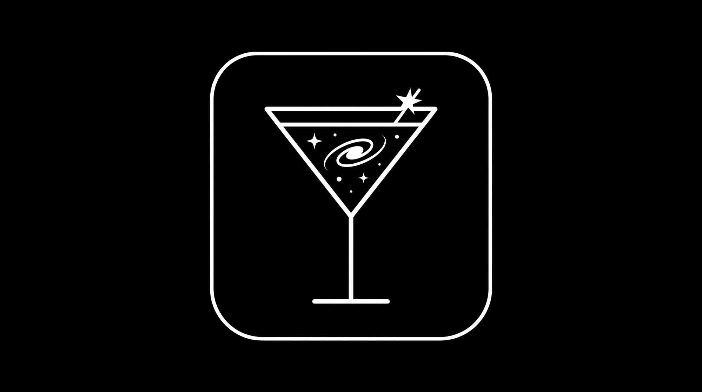

# Cosmos

**Cosmos is the Wine engine of [Cosmopolitan](https://github.com/cyber-prinzesse/Cosmopolitan)**, the free Mac launcher
for Windows games. It is based on Wine (Wine 11 for macOS, LGPL-2.1-or-later) and runs Windows games and programs on
Apple Silicon Macs under Rosetta.

## What makes it Cosmos

- **Every program has its own name and icon in the Dock.** Games started by Steam no longer show up as "Steam"; every
  program shows the Cosmos icon (Mac Driver `ProgramIcon=y` keeps a program's own).
- **One Dock icon for Steam** (Mac Driver `NoDockIcon` for its hidden helper).
- **Dark, like Cosmopolitan:** dark title bars, and a black theme for every window Wine draws itself (dialogs,
  installers, progress bars, buttons), in Cosmopolitan's colours.
- **D3D12 games don't freeze** on a fault in Apple's Metal threads; they end and the crash is reported.
- **Self-contained:** each engine carries the libraries Wine needs (FreeType, GnuTLS, SDL, MoltenVK).
- Built on [Highball](https://github.com/gauthierpiarrette/highball-engine)'s recipe and patch series: Steam and
  store fixes, x87 maths for old 32-bit games, spatial audio, and more ([`patches/`](patches/)).

## How it's built

[`.github/workflows/build.yml`](.github/workflows/build.yml) builds it on GitHub's Mac machines from the pinned Wine
source plus [`patches/`](patches/), recolours the theme ([`cosmos-theme/`](cosmos-theme/)) and bundles the host
libraries ([`cosmos-tools/`](cosmos-tools/)). Each build is `cosmos-<wine version>-r<N>.tar.gz` with a `COSMOS-BUILD.txt`
naming the exact source, patches and commit. Details: [COSMOS.md](COSMOS.md).

## Source

The complete source of any Cosmos build is the Wine source tarball in the
[`wine-source-11.0`](https://github.com/cyber-prinzesse/cosmos-engine/releases/tag/wine-source-11.0) release (pinned by
SHA-256 in [`inputs.json`](inputs.json)) plus [`patches/`](patches/) at that build's commit. Licence: LGPL-2.1-or-later
([`LICENSE`](LICENSE)); the copyright notices in the source stay as they are.

## Credit

Wine and everyone who works on it; Highball (gauthierpiarrette) for the recipe, the patch series and the people named
in [HIGHBALL.md](HIGHBALL.md); the DXMT, DXVK and MoltenVK authors. The Cosmos name and icon are Cosmopolitan's.
